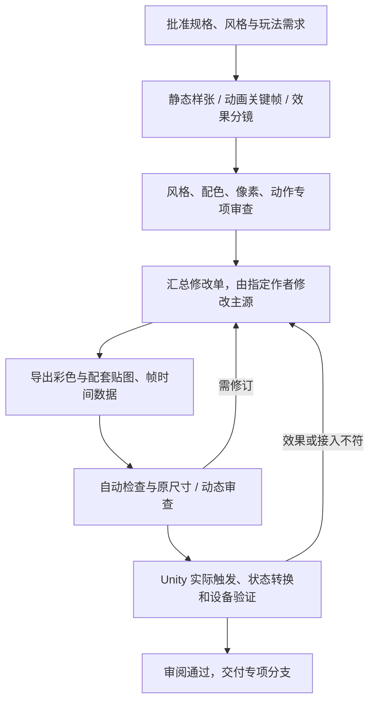

# 长期 2D 制作方案：关卡、美术、动画、特效与 AI 协作

审查日期：2026-11-08。项目基线：`codex/2d-vine-ending-fixes` / `69a8a4b`，Unity 6000.3.12f1、URP 17.3 Renderer2D。

本文是供审阅的方案。没有安装工具、修改代码或正式资源、迁移关卡、启动 Unity、提交或推送。当前正式权威仍为 Gaming Scene 及其引用的 GridArt 作者资产；下文的未来架构不表示已经实施。

## 1. 我的选择

**本项目优先采用“Unity 统一制作界面 + 原生地形工具 + 少量项目适配 + Aseprite 像素与动画源文件 + 专项贴图/特效工具”的混合方案。**

理由不是 Unity 在所有场合都最好，而是本项目已有真实 Prefab 引用、颜色玩法、房间重置、存档身份、Timeline 和自定义显示链。继续使用 Unity 编辑这些内容，比在外部编辑器重新实现一套属性、关系、预览和导入器更容易保持一致。

但这不等于继续维护一套包办所有功能的自研编辑器。网格绘制、选择、自动邻接、标准碰撞合并，应尽量交给成熟组件；项目只维护房间语义、机关绑定、身份、转换与必要校验。静态普通地形、装饰和有行为的实体，在同一视口制作，但使用适合各自职责的数据类型。

| 路线 | 在本项目的主要优点 | 要付出的长期维护成本 | 建议 |
|---|---|---|---|
| Unity Tilemap/RuleTile + 项目薄适配 | Prefab、Inspector、演出与运行预览在同一环境；不必复制全部玩法语义 | 必须补齐现有物理查询兼容、地形规则和房间工作流；大 Scene 仍需治理 | 首选，先做小范围验证 |
| LDtk + Unity 导入 | 世界/房间、IntGrid 与自动铺图工作流完整；可按关卡分文件 | 需要长期维护实体字段、引用、身份、房间和 Unity 特殊内容的导入契约 | 有力备选；若实测显著降低策划成本，再选为指定内容的唯一作者源 |
| Tiled + Unity 导入 | 通用图层、地形与 Automapping 灵活 | 仍需项目专属实体和导入约束；灵活性也增加规则配置面 | 团队已熟悉 Tiled 时更有价值 |
| 继续扩大当前 GridArt/自研系统 | 保留现有资产、工具与显示表现 | 选择、规则、地形、碰撞、协作和性能都继续由团队负责 | 保留兼容层，不作为所有新功能的默认实现 |

这是适配当前代码与团队情况的判断，不是已经完成的对比性能测试。详细工具对照见 [前一份选型报告](2D_LEVEL_EDITOR_TOOL_SELECTION_20261108.md)。Unity RuleTile 提供邻接规则等机制，LDtk Auto-layer 能从 IntGrid 派生铺图；它们仍需要团队制作素材及规则。[Unity RuleTile](https://docs.unity3d.com/Packages/com.unity.2d.tilemap.extras@4.0/manual/RuleTile.html)、[LDtk Auto-layers](https://ldtk.io/docs/general/auto-layers/)

### 1.1 必须坚持一个作者源

- 同一片普通地形只编辑一份地形数据，由它生成碰撞和默认外观。不能让白块与墙面分别成为必须人工同步的两张图。
- 自动地形外观允许人工覆盖，但覆盖层是显式的局部例外，不再修改第二份碰撞布局。
- 花草、碎石、背景等默认不产生玩法碰撞；可搬运物、门、水、藤蔓等仍是有行为的实体。
- 若试验 LDtk，只让指定试验内容由 LDtk 单向导入，不能同时在生成 Scene 和 LDtk 修改同一内容。
- 当前 GridArt 与 Gaming 不自动转格式。现有成果保留可读取、可回退，迁移只能在另一次明确授权与验证后进行。

### 1.2 统一界面应该怎么用

主界面是房间/世界导航、场景视口、一个可搜索的内容库和当前选择属性。内容库同时显示地形、装饰、机关和道具；选“石墙”就画地形，选“草”就放装饰，选“门”就放真实机关。作者不需要先猜它属于哪个内部系统。

工具负责清楚显示此次会修改的层、碰撞类型与房间归属。高级设置再展开，避免为了统一界面而把所有东西变成同一种对象。

洞穴可先填实体再挖通路，室外可从空白添加平台；两种手势编辑同一种地形。外轮廓、内角、墙芯、苔藓和背景的协调主要来自规则素材、明度层级及装饰布局，不能仅凭截图断言对方用了双网格。可以试验半格偏移的显示规则，但玩法网格和稳定坐标保持唯一。

## 2. 数据协作比选择哪个编辑器更重要

当前规则是 Scene 为玩法权威，GridArt Map/归属资产为美术权威；旧 planning JSON 只读。切换编辑器不能借机重新引入三份相互覆盖的关卡存档。

| 内容 | 建议负责者/作者源 | 合作规则 |
|---|---|---|
| 玩法房间、机关参数与引用 | 关卡作者 / Unity Scene | 按区域安排责任；交付需包含全部依赖，不用旧 Scene 全量覆盖新 Scene |
| 地形规则与内容模板 | 工具/关卡技术负责人 / 独立资产 | 模板更新不悄悄回写所有实例；规则变更提供前后预览 |
| 一个角色或动画组 | 指定美术作者 / 一个主源文件 | 多人和 AI 可以审查，同一时刻只由指定作者写最终版本 |
| 调色板、材质规范 | 美术负责人 / 版本化规范 | 变更有版本号与受影响资产清单 |
| 导出纹理和动画数据 | 固定版本的导出器 | 输出可复现；禁止人工修改导出图后不回写源文件 |
| Shader/渲染接线 | 程序/TA | 用明确贴图契约接入，避免各资产自行解释通道 |

“一个作者写最终版本”是防止二进制源文件互相覆盖的工作分工，不是再做一套场景对象锁系统。AI 评审意见统一汇总后再修改，不能让多个评审者同时覆盖同一个 `.aseprite` 或 `.psd`。

当前大型 Gaming Scene 也不会因为换成 Tilemap 就自动变得容易合并。后续可以专项评估按独立关卡拆 Scene，再通过受控加载进入同一世界；这需要先解决房间生命周期、相机、存档和跨 Scene 关系。跨 Scene 不能沿用普通场景对象引用的假设，也不能未经设计把现有全部机关关系改成字符串。**本轮不拆正式 Gaming，也不恢复旧片段拼图工作流。**

main 应由整合窗口接收经过审阅的专项分支；美术、程序和关卡按实际改动范围提交，不能通过“整份 Assets 覆盖”整合。大型二进制源文件是否采用 LFS 可另行制定团队统一政策；本轮没有改 Git 配置。

## 3. 多工具组合与使用边界

| 环节 | 首选工具 | 补充/替代 | 选用理由与边界 |
|---|---|---|---|
| 原生像素定稿、瓦片、逐帧动画 | Aseprite | 已熟悉其他像素工具可保留，但须相同导出契约 | 图层、帧、标签与像素操作适合小尺寸资产；主源保留可编辑性 |
| 概念、配色、构图、大图修整 | Photoshop 或 Krita | 生成图只作候选参考/草案 | 不要求每张小图经过此环节；PS 修过正式像素后必须回到批准的主源 |
| 法线/高光/AO 草稿 | Laigter | SpriteIlluminator 用于法线制作和灯光预览 | 批量草稿之后逐材质审查；不能将自动结果直接视为正确体积 |
| 程序化像素烟雾、溶解、火花序列 | Pixel Composer（可选） | Aseprite 定稿；Unity 粒子/Shader 处理实时部分 | 保留节点工程、种子与参数；输出仍需符合本项目像素与性能标准 |
| 场景、动画触发、交互效果、UI | Unity | 使用已接入的 Animator/Timeline/粒子与自定义 Shader | 真实播放、输入、暂停、中断、房间切换和目标设备测试必须在此完成 |
| 批量导出、像素/帧检查、审查图 | Aseprite CLI/Lua + 小型脚本 | Photoshop UXP 作为需要时的专门适配 | 自动化重复工作，最终保留可读报告和前后差异 |

Aseprite 提供动画帧、图层、标签、洋葱皮与帧时长；CLI 可以批量导出纹理和 JSON，Lua API 可以操作像素。Photoshop 的 UXP Imaging API 可直接读写图层像素；Krita 有逐帧栅格动画。这些是已核对的工具能力，并不表示本机已配置好相应桥接或许可证。[Aseprite 动画](https://www.aseprite.org/docs/animation/)、[Aseprite CLI](https://www.aseprite.org/docs/cli/)、[Aseprite Lua](https://www.aseprite.org/docs/scripting/)、[像素 API](https://www.aseprite.org/api/image)、[Photoshop Imaging API](https://developer.adobe.com/photoshop/uxp/2022/ps-reference/media/imaging)、[Krita 动画](https://docs.krita.org/en/user_manual/animation.html)

Laigter 官方仓库列出 normal、specular、occlusion、parallax 及无界面批处理。SpriteIlluminator 定位为法线编辑/生成和预览工具。Pixel Composer 是面向像素美术的节点式特效工具；本项目尚未验证这些工具的实际输出。[Laigter](https://github.com/azagaya/laigter)、[SpriteIlluminator](https://www.codeandweb.com/spriteilluminator)、[Pixel Composer](https://github.com/Ttanasart-pt/Pixel-Composer)

不建议一开始就把所有工具和所有插件都列为强制依赖。先形成 Aseprite、Unity 和一个贴图工具的可复现闭环，PS/Krita 与程序化特效工具按任务增加。也不必同时维护两套最终图集打包器。

## 4. 先定风格规范，再批量生产

规范需要有文字、实图和禁止示例，至少包含：

1. 世界像素基准、不同对象尺寸、UI 独立规格、相机目标显示比例。
2. 轮廓线粗细、内外轮廓差异、像素簇组织、斜线阶梯、允许的孤立像素。
3. 调色板的功能分组：背景、地形、角色、交互、危险、颜色钥匙语义。
4. 明度层级、阴影色阶与色相偏移；哪些表面允许亮斑、抖色或半透明。
5. 静态绘制的光照方向与动态灯光职责，避免同一凹凸被画和 Shader 各算一次。
6. 动画节奏、夸张程度、落地/接触锚点、材质运动方式。
7. 特效亮度、遮挡范围、信息优先级、移动端预算与降级方式。

现有有效像素标准继续使用 **16 源像素 = 1 格**；玩家现有 24 像素自然外观是 1.5 格，不能为了“统一规格”缩成 16。编码图尺寸需扣除已证实的导出倍率，不能根据看起来像放大图就猜倍率。已有 tail 的 4 倍例外不能扩展到其他素材。[项目像素约定](ART_GRID_CONVENTIONS.md)、[转换约定](SCENE_ART_PIXEL_CONVERSION.md)

新源文件优先原生 1 倍像素，展示图用整数最近邻放大。若定义新导入规则，PPU 需结合单格世界尺寸与现有换算实现，不能全项目盲设 16。色数也先通过风格样张确定，而不是强制所有资产共用某个任意色数。

“像素一致”不等于所有图都只能使用同一彩色调色板：法线是方向数据，灰度遮罩是数值数据，不能套用彩色美术的量化规则。粒子、雾和 UI 的透明度例外也应有资产类别说明。

## 5. AI 参与方式：多方审查，单一受控写入

建议把工作拆成可独立复核的交付，而不是让多个 AI 各自重画一遍后选最像的一张。

| 角色 | 输入 | 必须给出的结果 |
|---|---|---|
| 风格/参考分析 | 用户授权的参考、项目样张与玩法语义 | 可见证据、风格规则、推测与禁止混入的元素 |
| 配色/材质评审 | 调色板、角色与场景截图 | 有具体色值/区域的修改意见，检查危险与可交互物辨识 |
| 原型作者 | 已批准规格与动作需求 | 原尺寸样张、关键姿态或关键效果帧，不先铺开全部资源 |
| 像素结构评审 | 原尺寸图、最近邻放大图 | 标注坐标、图层、帧与问题类型；不只评价“高级/协调” |
| 动画/特效评审 | 完整时序、接触表与真实场景录像 | 节奏、动作连续性、信息表达、循环和中断问题 |
| 最终作者/整合者 | 汇总后的批准修改单 | 修改源像素、导出、导入与引擎证据；拒绝互相矛盾的修改 |

用户/美术负责人确定风格与取舍。我可以承担规范、脚本化像素制作、工具适配、差异汇总和 Unity 接入；其他 AI 提供的结论仍需证据和复核，不能保证自动得到“零混素”的审美结论。外部 AI 的连接和实际可调用工具需要后续配置，本轮没有调用或联系它们。

逐像素制作表示源像素的位置、RGBA、轮廓和帧之间的变化可控、可查看、可修改。可以通过 Aseprite 的像素 API 或专门脚本绘制像素簇，再在编辑器中审查；不必以逐次鼠标点击证明工作量。Aseprite API 对直接改像素的撤销有明确限制，适配时应使用文档建议的图像复制/替换方式保留撤销。[Aseprite Image API](https://www.aseprite.org/api/image)

PS 大图生成后缩小，不自动等于合格像素画。PS 进行颜色转换、缩放或修边后，应再次核对源像素、透明边和调色板；UXP 支持像素操作，也会涉及颜色配置转换。[Photoshop Imaging API](https://developer.adobe.com/photoshop/uxp/2022/ps-reference/media/imaging)



### 5.1 审查不要无限循环

先批准一套小型标准样本；同类资产复用标准，只对差异复核。通常一名作者、一名相关专项评审和整合审查即可；复杂角色/Boss/核心特效才扩大评审。

意见分为阻断问题、风格建议、可选变体。每条应指向帧/坐标/场景条件和预期行为；作者修后只复核受影响部分。没有新增变更或证据，不反复运行同一套昂贵测试。

## 6. 静态、动画与功能效果分别验收

### 6.1 静态资产

- 原生 1 倍检查形体和辨识度，整数放大检查像素簇、斜线与轮廓。
- 黑/白/中灰与真实背景上检查透明边和对比度。
- 地形检查直边、外角、内角、单格、窄柱、平台底面和不同材质交界。
- 对照碰撞线与站立面检查脚底、梯子前后层、门/收集品/隐藏块层序；视觉外框不等于碰撞外框。
- 检查不同颜色状态、明暗状态和目标屏幕上的可读性。

### 6.2 动画组

先交关键姿态与时序，再补中间帧；帧数和时长服从动作，不把所有动画统一成固定帧率。保留标签、每帧时长和播放方向；Aseprite 标签可以表示正放、倒放或往返。[Aseprite Tags](https://www.aseprite.org/docs/tags/)、[帧时长](https://www.aseprite.org/docs/frame-duration/)

| 审查层 | 检查内容 | 证据 |
|---|---|---|
| 单帧像素 | 轮廓、颜色、体积、肢体、像素大小 | 全帧接触表，逐帧编号 |
| 相邻帧 | 不合理抖动、五官漂移、纹理爬动、体积突变 | 洋葱皮/前后帧叠图；有意变形单独注明 |
| 锚点与轨迹 | 站立脚不滑、接触点不漂、转身不跳位置 | 脚底线、枢轴线、轨迹；跳跃等动作按自身设计审查 |
| 时间与循环 | 起势/发力/停留/恢复清楚，末帧到首帧连续 | 保留真实时长的循环预览与慢放 |
| 状态衔接 | 待机→走跑→跳落、攀爬→跳、受击/死亡优先级 | Unity 中触发转换的录像 |
| 玩法同步 | 事件时机、命中/无敌/交互阶段匹配，动作不私自推动根对象 | 状态/事件时间表及运行验证 |
| 多贴图 | 彩色/法线/高光/发光的帧号、裁切、枢轴、时长一致 | 同步灯光预览，检测高光闪烁与接缝 |

导出必须带实际时间信息；一排 PNG 自身不能保存原动画的时长含义。GIF/视频适合审阅，运行资源使用已约定的帧/纹理与动画数据。预览播放器的缩放、色彩和时间误差不能代替 Unity 验收。

不建议把 AI 对每帧自由重生成当作最终逐帧生产线：小尺寸的形体、装备、轮廓和接触点容易漂移。先锁定角色设计与关键帧，再受控补帧；任何自动补帧都回到源像素审查。

### 6.3 玩法特效与功能效果图

“功能效果图”分两种交付：解释功能的设计图/状态图，以及实际运行特效；两者要对应，但前者不能证明后者已接入。

每个效果需求至少注明：触发条件、预告、发生、持续、结束/取消、影响范围、层序、可否中断、暂停规则、音效配合、手机适配。门、钥匙、重生点、开关、染色、危险区都要有可辨别的状态；不能只交一张发光效果图。

| 类别 | 额外审查重点 |
|---|---|
| 火花/爆炸/烟雾 | 轮廓阶段、运动方向、消散，无莫名弹出或硬切；不遮住关键地形与玩家 |
| 水/折射/光照 | 相机不同距离、Scene/Game、画面边缘、切房和遮蔽切换；避免此前采样与缓存问题回归 |
| 故障/溶解/染色 | 颜色语义、轮廓阈值、结束后材质/遮罩恢复；与已有 HSV、燃烧效果共存 |
| 门/机关反馈 | 未满足、可交互、激活、冷却/锁定各状态明确；视觉不擅自更改玩法信号 |
| UI/操作提示 | 触摸/按下/禁用、长文本、横纵比与安全区、TapTap 原生按钮避让；实际触屏验证 |
| 剧情/镜头效果 | 时间线跳转、取消、存读档后恢复；不遗留镜头或输入接管 |

固定种子或可复现的录制用于前后对比，随机变体另测。实时粒子/Shader 应测试重复触发、叠加、切房、回收、暂停和前后台；动画结束后不遗留粒子、订阅、材质实例或镜头请求。运行时使用 2D 表现与排序，不为制作这些贴图重新引入 3D 玩法。

## 7. 配套贴图：按材质需要制作，不机械凑套数

### 7.1 资源包应包含什么

| 贴图/数据 | 用途 | 建议 |
|---|---|---|
| Color/Albedo | 本体颜色与轮廓 | 每项必需；明确哪些阴影/高光已画入 |
| Normal | 动态灯光下的表面朝向 | 有体积表现的地形、金属、角色按需制作；普通 UI 不强制 |
| Height | 生成/编辑法线与凹凸的中间源 | 建议重要材质保留；不是必须送入运行时 |
| AO | 缝隙、接触和局部环境遮蔽强度 | 低强度；避免把已画暗部重复压黑；不等于全场景遮挡系统 |
| Specular strength / Roughness | 哪些位置反光、反光强度/宽窄 | 金属、湿润表面按需；二者不是同一含义，不能互换文件 |
| Emission | 发光范围与强度控制 | 用于灯、钥匙/能量等需要自发光的部分；与彩色语义区分 |
| Material/Color mask | 指定染色、材质或灯光影响区域 | 按 Shader 的已定义通道使用，不随意挤占已有 HSV/遮蔽遮罩 |
| 动画元数据 | 帧、时长、标签、枢轴、事件契约 | 动态资产必须配套，不能只交一张总图 |

“高光图”应先约定具体含义：是已经画在颜色图中的亮斑、动态反光强度图，还是粗糙度图。三种交付不可混叫。Metallic 也不作为所有像素资产的必选项。

### 7.2 当前项目真实支持情况

- `GridArt.shader` 是 `2026TapTap/Grid Art/Unlit`，只采主图和色值，没有读取法线、AO 或高光。
- `WorldObjectSprite.shader` 虽有 `Universal2D` Pass，但片元是主图、显隐与燃烧处理；没有标准 2D 法线/灯光求解。仅有这个 Pass 标签并不代表已受 2D 灯光照明。
- `GridArtBuilder` 传递 `normalMap` 并按其分组，但光照分支仍是 `lighting3D` → `Universal Render Pipeline/Lit` / `_BumpMap`。这条旧分支不能当作当前 Renderer2D 的完整材质方案。
- 本机 URP 包的 `Sprite-Lit-Default.shader` 有 `_NormalMap`、`_MaskTex` 和 `NormalsRendering` 路径。Unity 官方给 Sprite 的 Secondary Textures 定义了这两个绑定名称；这不表示自定义 GridArt Mesh 会自动获得同样能力。[Unity 6.3 Secondary Textures](https://docs.unity.com/en-us/engine/6000.3/manual/unity2d/2d-urp/2d-index/secondary-textures)

源码入口：[GridArt Shader](../../Assets/_Project/Code/Systems/GridArt/Runtime/GridArt.shader)、[物体 Shader](../../Assets/_Project/Code/Systems/ObjectArtwork/Runtime/WorldObjectSprite.shader)、[GridArtBuilder](../../Assets/_Project/Code/Systems/GridArt/Editor/GridArtBuilder.cs)。本轮只静态核查，未进行新贴图的 GPU 渲染验收。

因此，“生成配套贴图”与“补齐 2D 材质显示链”需要作为配套交付。标准 Sprite Lit 可以作为参考；项目材质仍要保留颜色显隐、HSV、燃烧、房间遮蔽和像素采样。不能直接替换材质后以法线能显示为由忽略这些功能。

标准 2D 的 mask 是灯光混合等用途的输入，不是任意 AO/高光/粗糙度图放进去都会按 PBR 解释。额外材质效果必须先明确 Shader 契约、通道及性能，再决定是否打包或合并纹理。法线光照也不能代替门/墙的阻光和房间可见性。

### 7.3 正确制作顺序

1. 批准颜色图与材质分区，明确动态灯光目标。手绘颜色中的深色不必然是凹陷，亮色也不必然是凸起。
2. 从有意设计的高度/材质遮罩生成法线、AO/高光草稿；直接按彩色亮度生成的结果只作参考。
3. 人工检查大形体与像素簇，不把每个纹理亮点都变成鼓包。静态美术的阴影与动态法线要协调。
4. 先在独立预览中检查中性光、上下左右斜光和移动光，检查凹凸是否反转、边缘是否发黑/发亮。
5. 进入真实房间，查看明暗背景、正常/染色/隐藏状态、拼接边、透明边、移动与不同相机距离。
6. 动画所有贴图使用同一帧表、矩形与枢轴，避免每帧独立自动生成导致体积闪烁。翻转/旋转时也检查法线朝向。
7. 经目标设备性能验收再扩大生产；有些资产保留平面法线或无 AO 的默认值，比强行做满贴图更好。

### 7.4 导入与采样契约

- 同一组贴图同尺寸、同帧裁切、同 UV、同 atlas 位置关系，保留透明外框与锚点。
- 颜色贴图按约定色彩空间导入；法线按 normal 类型处理，AO/粗糙度/遮罩作为数据纹理，不能套用颜色图的 sRGB 转换。
- 规定法线 Y 方向和切线基准，通过实际灯光验证，不能仅凭“DirectX/OpenGL”文件名判断。
- 彩色层量化不作用于法线方向；法线向量需正确解码/归一化。是否用平滑或分级法线由风格样张决定。
- Point、padding、透明边扩展、图集隔离和 mip 策略按最终相机距离验证；不以所有资源一刀切的导入开关代替验收。
- 禁止恢复已修过的图集边界漏采样、纹理错帧或远景折射条纹。

额外贴图有成本：举例，1024×1024 的 RGBA32 未压缩单图约 4 MiB，不含 mip；四张约 16 MiB。实际格式、压缩、驻留和图集会改变成本。这不是当前项目测量值，说明为何应按材质配置贴图，而非所有小物件机械生成四张。

## 8. 交付包、自动检查和人工审查

建议一个资产或动画组包含：

```text
资产主源：一个批准的 .aseprite / .psd / 程序化特效工程
规格：assetId、类别、源像素尺寸、导出倍率、像素规范版本
动画：标签、每帧时长、枢轴/接触点、事件意图与循环方式
材质：Color + 按需的 Normal/AO/Spec/Emission，通道定义
导出：固定命令/脚本版本；参数、随机种子与输入摘要
审查：原尺寸、整数放大、逐帧接触表、动态预览、Unity 场景证据
接入：Unity .meta、所需材质/Prefab/动画/依赖及变更说明
```

PS 和 Aseprite 都可以参与，但每项交付须指明哪一个是最终主源。例如 PS 概念稿 → Aseprite 定稿；若 PS 最后修了定稿像素，需把修改回写主源并重新导出，不能留下两个互相矛盾的“最终版”。法线等子源允许单独保存，但须与同一资产版本绑定。

Aseprite CLI → PNG/JSON → Unity 是较容易控制的第一条导出链。Unity 也提供 Aseprite Importer，但当前 manifest 未声明它；是否改用直接导入须验证所需版本、帧时长、切片/枢轴、引用稳定性和多贴图，不能直接替换现有导入器。[Unity Aseprite Importer](https://docs.unity3d.com/Packages/com.unity.2d.aseprite@1.0/manual/index.html)

| 自动化可以发现 | 仍需人工/语义审查 |
|---|---|
| 尺寸/倍率不符、调色板越界、疑似半透明边、异常独立像素 | 故意的粒子、反光、半透明与孤立像素是否合理 |
| 贴图组尺寸/帧数不符、漏帧、时长缺失、atlas 越界 | 动作力度、材质可信度、画面气质是否符合目标 |
| 未导出、依赖缺失、GUID 变化、引用丢失、实例数据意外改写 | 姿态好不好看、危险/交互是否直观、背景是否抢戏 |
| 指定场景截图差异、暂停/取消/切房后的残留 | 差异是批准改善还是风格偏离，允许的例外是什么 |

自动检查标注疑点，不直接清除所有“可疑”像素。检查通过也不等于审美已经通过。源文件变化与导出图变化应一起审阅，并尽量沿用现有 `.meta` 和切片身份，避免动画、Prefab 和存档引用断链。

小图的像素修改不要求每次完整双端打包；按影响运行对应导入/视觉/动画专项。Shader、图集格式、内存和实时特效等影响设备的改动，需要代表性 PC/手机验收。没有变化的测试结果可复用，不重复耗时构建。

## 9. 参考公开 Skill 的方式

已阅读公开的 [SummerEngine sprite-sheet Skill](https://github.com/SummerEngine/summer/blob/main/plugins/claude/skills/sprite-sheet/SKILL.md)。可借鉴的是：把图组生成与切片分开、承认帧间一致性风险、区分静态变换与逐帧动作，以及列清工具依赖和交付步骤。它针对另一套引擎与服务，不能直接移植其工具调用，也不采纳未经本项目验证的质量或耗时保证。

它的“一张生成图直接做完整动作图组”等路径不作为我们的最终标准；仍需通过源像素与时序审查。公开 Skill 只是参考资料，没有在本机安装，也没有执行其中脚本。

后续项目专用流程可以拆成：

| 流程模块 | 输入与完成标准 |
|---|---|
| 风格与像素规范 | 参考→样张/调色板/像素规则，需明确批准版本 |
| 静态与规则瓦片制作 | 原生像素→源文件、边角/拼接测试、导出 |
| 动画制作与审查 | 动作表→关键帧→补帧→接触表→真实状态转换 |
| 特效与功能反馈 | 状态需求→分镜→运行效果→中断/回收/设备验收 |
| 材质贴图与 2D 光照 | 材质意图→同步贴图→Shader 契约→多光向/设备检查 |
| Unity 接入与交付 | 稳定身份/依赖→导入→最小回归→审阅材料 |

这是建议的流程模块，不是本轮已经创建的 Skill。每项只加载当前任务需要的步骤；不要让做一枚静态小图标的任务先跑完整 Boss 特效和双端构建流程。

## 10. 最小验证样板与后续顺序

先做一个独立测试房间，避免再以正式地图充当试验场：

1. **地形样板**：一套墙芯、地面、边角、窄柱、洞口和装饰；验证一次绘制产生预期碰撞与外观，手修不破坏地形。
2. **角色/物体样板**：一个有原地/移动/跳落或开关状态的对象；验证枢轴、贴地、过渡与导出重现。
3. **材质样板**：石、金属、湿润表面各一小块，比较无动态光与 normal/AO/高光方案。
4. **效果样板**：一个可重复、可中断的颜色/机关效果；核对房间切换、暂停和手机显示。
5. **协作演练**：两人分别改房间与素材，通过源文件、`.meta`、依赖和审查图交付，确认无全量覆盖、丢引用或随机重建。

通过后再决定是否推广 Unity 地形方案；若策划实际操作仍比 LDtk 明显困难，再用同一个样板对照 LDtk。评价条件是实际操作步骤、错误率、重开恢复、Undo、引用稳定性、像素效果与目标设备性能，不是插件宣传或菜单多少。

当前迁移的技术门槛已经确认：`PlanarPoseQuery.Copy` 只支持 Box/Circle/Capsule/PolygonCollider2D，未支持 TilemapCollider2D/CompositeCollider2D。只证明原生 Tilemap 能碰撞还不够，必须覆盖搬运放置等假想姿态查询及房间/颜色边界，再谈正式迁移。[查询实现](../../Assets/_Project/Code/Systems/PlanarPhysics/Runtime/PlanarPoseQuery.cs)

本轮结论可供确定制作方向；实际试点、工具安装、Shader/导入器开发和正式场景迁移仍是后续专项。没有将研究建议伪装成已经完成的制作能力。
