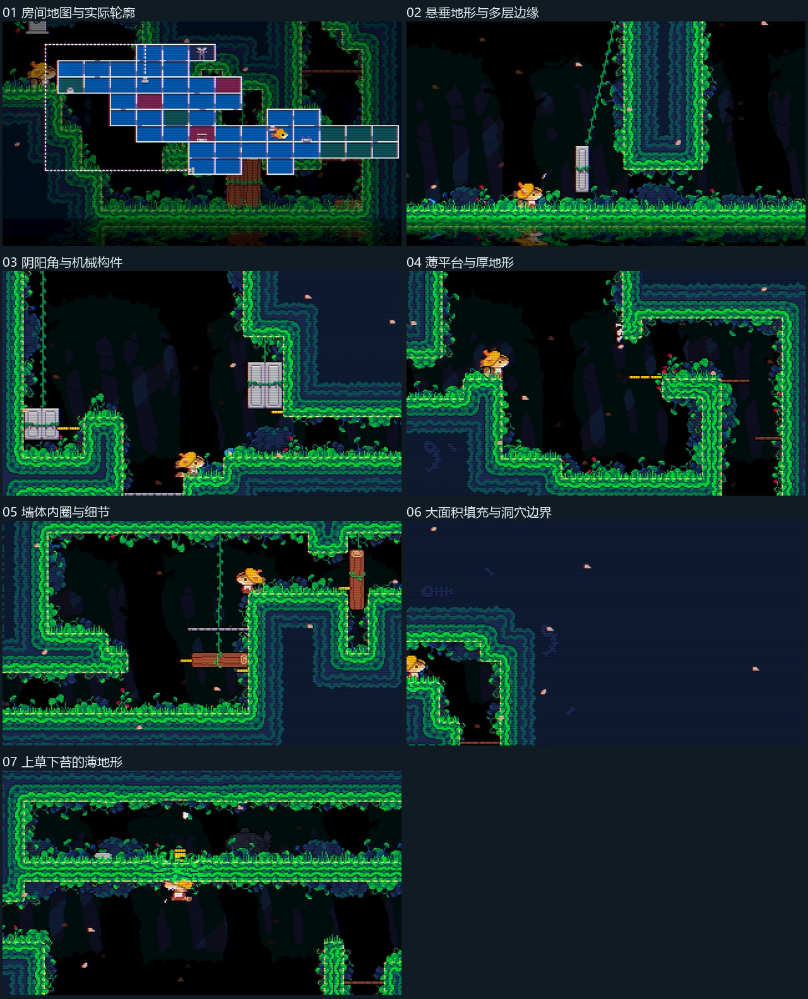
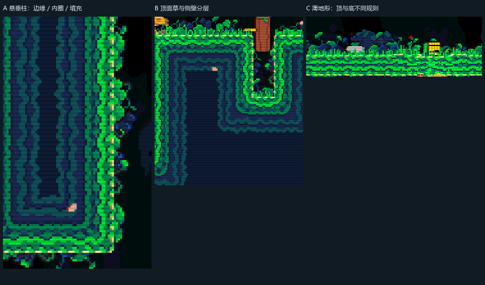
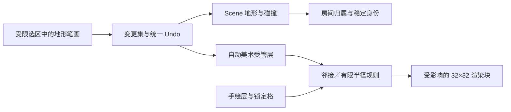

# SilenceGarden 截图：地形美术与关卡编辑工作流分析

审阅日期：2026-11-06。依据用户提供的七张 3840×2160 截图及当前 `codex/2d-vine-ending-fixes` 源码。这里只分析和提出方案，本次没有修改关卡编辑器面板，也没有把参考游戏的美术加入运行资源。

## 1. 先回答三个问题

**画面协调主要来自“连续地形轮廓、方向明确的边缘、向内过渡的墙体填充、少量人工装饰、统一像素尺度与明暗层次”的配合。** 自动选瓦片可以完成基础连接，素材与布局本身仍决定最终质量。

**“先铺一大片实心区域，再挖出房间”很适合复刻这种制作体验，但截图无法证明原作者使用了这个顺序。** 相同的地形占用数据，既能通过添加地形得到，也能通过填满后挖空得到。截图只能证实有大面积连续实体、洞穴与悬垂地形，不能反推出真实编辑器操作、引擎或源文件组织。

**能看到多个边缘层次，但不能据此断定使用了双网格。** 同格自动瓦片、四分块拼接、角点地形、半格偏移的双网格、人工多层边框都能产生相似结果。我们当前已经有四分块自动边角，优先补全地形与美术的联动、材质边界和装饰规则，比直接重做双网格更有收益。

## 2. 七张图分别提供了什么证据

下图编号与用户上传顺序一致；缩略图用于定位，细节判断来自原图。截图的横向扫描线与部分彩边贯穿角色、背景和地形，属于画面处理的迹象，不能把它们当作瓦片接缝或素材网格。

| 图／时间 | 直接可见的细节 | 对工作流的推断与限制 |
|---|---|---|
| 01／22:45:46 | 地图叠加层以规则矩形表示房间，底层绿色地形仍呈不规则轮廓；墙与树干不按地图色块边界截断 | 房间导航信息和可见地形可以分离。地图小格不能用来测量原游戏的碰撞格或证明它采用双网格 |
| 02／21:59:13 | 悬垂柱侧面连续，下端圆转；亮绿苔边内侧有多圈深蓝条带；藤条越出主轮廓，草与花集中在上表面 | 至少需要区分顶、底、侧、内角、外角；很可能包含可重复边缘和填充模块，再叠加装饰。内部条带也可能已经画进宽边缘素材，不能断言运行时计算了距离场 |
| 03／21:56:51 | 大空腔的阴角与阳角都有转接；机械方块、黄色连接杆采用另一套清晰造型；背景树干弱于前景地形 | 自然地形和机关需要独立素材与逻辑。不要让全局自动铺地形覆盖机关、运动路径或可交互位置 |
| 04／22:02:45 | 小悬浮台仍保留完整草顶与暗底；细棕平台和厚墙明显不同；石块、花、草簇在落脚面形成不均匀小组 | 一格厚／薄平台应有专用规则，不能只拼两个普通边缘。人工小组合能打破重复，但截图不能证明装饰全部由程序散布 |
| 05／22:17:32 | 右侧厚地形内部有连续凹槽状蓝色边圈；凸台顶面铺草，底部悬苔；灰色薄平台与木质机关保持单独轮廓 | “骨架形状→按朝向分边→内侧收边→局部装饰”可以解释这种层次；需要保留机械平台和自然地形两种作者对象 |
| 06／22:19:14 | 右侧与上方是大面积暗蓝墙体，左侧洞穴显示低对比树干；两者之间有较亮的苔边和数圈内缘 | 地形内部需要低干扰的填充，不能全铺高亮边框。大面积墙体适合区域填充／挖洞；这仍是推荐工作流而非原作者操作证据 |
| 07／22:24:50 | 很薄的横向地形，上面是草和小石，下面是垂挂苔与石片，玩家在下方时轮廓清楚 | 顶面装饰和底面装饰需要不同方向规则。装饰能超出碰撞轮廓，但角色可走面必须与碰撞一致 |

## 3. 为什么墙壁和地板看起来是一体的

### 3.1 先统一轮廓，再分辨方向

同一块连续地形同时承担地板、侧墙与天花板。它们的差别来自暴露面的朝向，而不是先分别摆“地板图片”和“墙图片”，最后设法把两者接起来。外轮廓闭合、拐角有专门素材，便能避免一到墙脚就出现直角拼缝。

草集中在朝上的可站立表面，底面多用垂挂苔和暗石；左右侧边没有直接把草顶旋转过去。自然主题中的光照和重力方向明确，任意旋转同一张边缘图通常会破坏这种可信度。

### 3.2 边缘、过渡带、填充分工

可见层次可以概括为：洞穴空气／背景 → 外伸的小草或苔 → 主地形轮廓 → 向内的蓝绿过渡带 → 更暗、更平静的填充。亮度和细节集中在可行走边缘，墙芯减少噪声。角色和机关使用更温暖或更高对比的色彩，依然容易被看到。

平行内圈可以由美术直接画进边缘瓦片，也可以用多层规则按距边界的格数生成；目前没有证据在二者之间作选择。复刻时应让美术先决定宽度与节奏，再决定算法。

### 3.3 重复中有变化

长直边的主体可以重复，草尖、石头、花、裂隙和藤条在不同位置打破节奏。多个装饰形成疏密组合，角色落脚点和机关附近留出阅读空间。所有地方使用相同密度的随机小草，反而会损失这种有意安排的效果。

前景装饰偶尔遮住接缝，但不应遮住所有关键机关。背景与前景的明度、饱和度和运动幅度不同，也让同一组地形更容易融入环境。换一套自动瓦片并不能单独获得这些结果。

## 4. 自动瓦片、四分块与双网格的区别

| 方法 | 作者主要编辑什么 | 显示如何推导 | 适用点／代价 |
|---|---|---|---|
| 同格邻接规则 | 地形格及材质 | 检查周围格，选择中心、边与角 | 容易对照碰撞格；复杂接缝需要更多规则与素材 |
| 四分块自动边角 | 同样的地形格 | 每格分四块，各块查询横邻、纵邻与斜邻 | 当前项目已具备；能独立处理一个格内的不同角，但仍要处理薄条、孤点与材质交界 |
| 角点／双网格方案 | 一个主网格上的占用或角点值 | 由四个相邻二值样本决定另一套显示单元，常把显示网格错开半格 | 四个二值样本有 16 种组合；适合连续边界。需要明确孤点、斜对角、地图边界和碰撞对应关系 |
| 多层地形规则 | 地形数据加主题／规则 | 分别生成填充、边缘、草、阴影、装饰 | 能做更丰富的视觉层次；要解决规则优先级、覆盖和手绘保留 |

Unity 的 Rule Tile 支持按邻接模式选择输出，并提供变换和随机输出；它说明规则铺图是成熟能力，不说明参考游戏一定使用了它。[Unity 官方 Rule Tile 文档](https://docs.unity3d.com/Packages/com.unity.2d.tilemap.extras@4.0/manual/RuleTile.html)

Tiled 的 Terrain Set 区分角、边以及二者混合的匹配方式，因此“转角自然”本身并不是双网格的独占特征。[Tiled 官方地形文档](https://doc.mapeditor.org/en/stable/manual/terrain/)

LDtk 的 Auto Layers 根据网格模式生成瓦片，并可使用 IntGrid 作为来源。这种把逻辑输入和自动美术输出分开的组织方式，可作为我们方案的参考。[LDtk 官方 Auto Layers](https://ldtk.io/docs/general/auto-layers/)、[规则说明](https://ldtk.io/docs/general/auto-layers/auto-layer-rules/)

**四分块不是“两套偏移网格”的同义词，16 种角点组合也不是我们当前 13 张源片的直接替代关系。** 参考图没有暴露作者格、规则库或半格偏移，暂时应把“双网格”列为可验证方案。

## 5. 我们现有编辑器已经有什么

以下来自当前仓库的实际代码，不是假设：

- 正式编辑权威是 `Gaming.unity`，房间格来自 `RoomLifecycleManager.Regions`；对象是真实 Prefab／组件，保留作者 ID、区域归属和机关 Unity 引用。
- 美术权威是 Scene 引用的 `GridArtMap`。图层已有隐藏、锁定、视差、颜色与排序数据；上万美术格没有逐格变成 GameObject。
- `GridArtBrush` 已有 `autoTerrain` 和 13 个源片槽，包含中心、边角与内角。`GridArtBuilder.BuildQuads` 每格产生四个四分块，分别检查横、纵、斜邻。因此现有工具并非只能手动刷单片墙。
- 当前邻接用 `GridArtRules.Same` 判断同笔刷。相邻两种墙面即使物理连续，也可能被当成两个不相连的美术区域；需要地形连接组，而不是只比较素材编号。
- 美术按 32×32 块保留生成；真实笔画才更新 revision，并已有受影响邻块刷新。后续应沿用这一机制，不能恢复每次重建整张图。
- 区域整体移动通过显式 `GridArtRegionOwnership` 带走已认领美术；未认领的旧美术不会被自动改归属。
- 项目基准为 16 个有效美术像素／格，逻辑占格与外观尺寸分开。换素材不能通过任意拉伸把图片填满碰撞框。

代码入口：`GridArtPalette.cs`、`GridArtMap.cs`、`GridArtBuilder.cs`、`SceneArtAuthoring`、`SceneObjectAuthoring`、`SceneRegionAssembly`。现有流程见 [SCENE_LEVEL_EDITOR.md](SCENE_LEVEL_EDITOR.md) 与 [ART_GRID_CONVENTIONS.md](ART_GRID_CONVENTIONS.md)。

## 6. 推荐怎么改编辑器

### 第一阶段：做一个房间可验收的地形闭环

1. **增加地形画笔，而不增加另一套房间坐标。** 工具提供添加实体、挖空、矩形填充、受边界限制的连通填充、吸取材质和预览。区域格仍代表房间归属，不能把“房间内”全部解释为实心。
2. **同一笔画产生碰撞与基础美术变更计划。** 先显示将增删的地形、碰撞轮廓与自动美术范围；确认后作为一个 Undo 事务提交。地形占用作为派生数据时由 Scene 地形提取，不能再创建一份与 Scene 双向同步的权威 JSON。
3. **填充限制在显式选区或当前房间内。** 洞穴外部没有选区时拒绝无界洪水填充；不按整张世界包围盒创建海量对象。通道和跨房间共用边界单独核对，不能挖穿相邻房间。
4. **自动规则只管理自己的图层。** 提供“自动填充／自动边缘／自动细节／手绘修饰”分工，明确哪些格由工具维护。已有 TA 手绘不应因移动一面墙而被重铺。
5. **先补基本形状。** 把孤立格、两格窄柱、一格厚横条、L 形、凹口、洞、阶梯、平台端点和左右边界做成固定样例。先让基础规则稳定，再追求复杂藤条散布。
6. **增加差异检查。** 同屏切换碰撞轮廓、地形格、自动美术与手绘；列出“实体无外观”“墙外观无碰撞”“一向平台无正确可站边”等分类。纯背景、装饰超出轮廓和水触发器必须可显式排除。

最小版并不要求马上换为 Unity Tilemap。先让现有 Scene 对象作者系统与 GridArt 在同一事务中协作；若需要新的压缩地形作者组件，应通过单独迁移工具明确创建，保留旧数据直至验证通过。

### 第二阶段：补画面的连续性

- **材质连接组与交界规则：** 同类地形换花纹仍连边；石／土／金属等真正交界才使用专门过渡。不能把所有材质强行连接。
- **朝向与厚度规则：** 顶面草、侧苔、底部悬挂分开；一格厚地形和窄柱使用专用输出，避免上下边缘互相覆盖。
- **多圈内缘：** 先试宽边片，再决定是否按距空气边界的格数输出数圈过渡。内部洞边同样参与距离计算。若使用距离场，必须明确最大影响半径和增删墙后的失效范围。
- **稳定变化：** 随机变体由主题种子、图层稳定 ID 和绝对格坐标确定，不能按绘制遍历顺序或每帧随机。修改邻墙不应让整间房的草重新洗牌。
- **装饰约束：** 只在合格朝向、足够长度和安全区外生成，配置间距、组簇、概率、可视超出范围及禁放标签。门口、机关读数、剧情站位、落脚点优先保证可读性。
- **人工覆盖：** 支持钉住某格、画局部修饰、清除单处自动装饰。重算保留钉住和手绘层，不把作者劳动当作临时输出。

### 第三阶段：用小样决定是否上双网格

选择一个典型房间，用同一份占用形状分别跑现有四分块与角点／双网格原型。对比转角质量、孤点、斜接触、薄墙、碰撞对齐、美术制作量和局部刷新耗时，再决定采用哪种。

即使选择双网格，碰撞仍由逻辑实体生成；半格显示偏移不得移动房间、重生点、机关或玩家。细边装饰也不应默认产生碰撞。双网格解决边界采样方式，不能替代主题素材、规则分层与编辑器事务。

## 7. 防止再次出现关卡编辑卡顿

建议的数据流：

静态碰撞可以按块或连续轮廓合并，但要保留孔洞和一向平台语义，不能用一个包围盒封住洞。水、藤蔓、机关、触发器、移动物体和有身份的道具不参加普通墙体合并；有物理行为的边界必须独立。

每次笔画只更新变化范围及规则所需外扩，不按 SceneView 鼠标移动频率全场扫描，不在每次 Repaint 重算地图，不为每个装饰格生成常驻 GameObject。材质主题或规则库整体变更可以显式重建，但应显示范围与进度，能撤销，不隐式保存正式 Scene。

32×32 渲染块不代表可以只查块内邻居：块边规则必须读取邻块，并把受影响块一并标脏。多圈内缘、长装饰和阴影的影响范围也应纳入失效传播，不能沿用只刷新一格邻居的假设。

## 8. 关卡与美术的具体协作流程

1. 策划画房间归属、通道和移动／跳跃骨架，在一个测试房间验证可达性。
2. 选择地形主题；用添加与挖空画出连续实体，编辑器同步生成基础碰撞和受管美术。
3. 摆机关、门、颜色物体和重生点；它们保留独立作者对象与稳定引用。
4. 切换碰撞叠加，修正落脚面、薄墙、转角和平台端点；先保证逻辑边与可见边一致。
5. 美术调整边缘变体、草和苔规则，再在手绘层加石块、花、藤条和局部修饰。
6. 从玩家实际镜头核对明暗、像素比例、层序与机关可读性，再看世界装配图。世界缩略图好看不等于实际游玩构图好。
7. 保存、重开、Undo／Redo、整房移动后再检查：地形、碰撞、美术与绑定都应保持对应。

“整块填满再挖空”可作为第 2 步的一个模式，室外、浮岛和小平台则更适合添加模式。两种模式共用同一份地形表达和同一套规则。

## 9. 下一项编辑器任务的验收建议

| 验收面 | 必须看见的结果 |
|---|---|
| 结构保护 | 正式关卡迁移前后，实体占用、孔洞、特殊平台和机关引用逐项对照；误差不能靠“看起来差不多”接受 |
| 视觉样例 | 一格薄条、独柱、L／U 形、内洞、对角接触、长直边、不同材质交界都有稳定结果 |
| 像素与层级 | 使用项目 16 有效像素／格基准；草与苔可外伸，玩家脚底与可站边一致，装饰不能遮死必要提示 |
| 编辑事务 | 一笔一次 Undo，重做结果一致；自动层重算保留手绘与锁定格；开窗、选素材和移动镜头零写入 |
| 局部性能 | 在真实 Gaming 测量连续绘制、矩形挖空和跨块笔画的中位数／P95／最大停顿；记录机器与格数，不能以空场景帧率代替 |
| 数据稳定 | 保存重开后 ID、种子、材质连接组、区域归属和覆盖格不变；整房移动不带走全局背景或未认领旧美术 |

建议先完成第一阶段的小房间闭环再审美术效果。现有基础已经支持邻接和分块，主要欠缺的是地形作者动作、碰撞／美术一致的事务、主题连接和装饰层规则；无需以一次重写整个关卡编辑器作为起点。

## 10. 引用与可信度

- 七张用户提供的本地截图：只用作画面证据；没有获得原游戏源工程或作者流程记录。
- Unity 官方 Rule Tile、Tiled 官方 Terrain Set、LDtk 官方 Auto Layers：只支持成熟工具具有相应规则能力，不作为参考游戏使用这些工具的证据。
- 当前仓库源码：用于核对我们已有的四分块、13 源片、32×32 分块、Scene 作者数据与区域归属机制。
- “挖洞制作”“距离场内缘”“自动装饰分布”“是否双网格”均保留为候选解释或方案，需要原工程、录制的制作过程或原作者说明才能确认。
